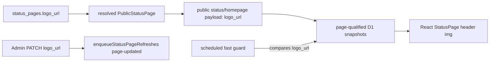

# Spec: Status-page custom logo

## Task

Give each `status_pages` row an optional external logo image URL that is rendered in the public status-page header. The value flows through the existing branding pipeline: `status_pages` row → resolved `PublicStatusPage` → public payloads → D1 snapshots → React rendering, with the same page-isolation and refresh guarantees as `title` and `description`.

## Output Language

Human-readable prose is English. Paths, schema fields, API names, commands, identifiers, and canonical terms remain literal.

## Problem

Status pages can customize `title` and `description` per page but have no visual brand mark. Admins running multiple public status pages (or a custom-domain page) cannot show their own logo; every page renders a plain text title. The branding-ownership spec (2026-07-11) explicitly deferred logo as a non-goal; this task promotes it into scope using the same ownership rules.

**Design risk**: High — cross-module data flow (D1 migration, Worker public payload/snapshot contracts, Admin API, React rendering) plus persisted state and a compatibility surface (stored snapshots).

**Diagram decision**: required

**Diagram reason**: the logo value crosses storage → resolver → payload builders → snapshots → React, and snapshot invalidation depends on a fast-guard comparison that must include the new field; the flow diagram keeps the ownership chain explicit.

## Confirmed decisions

- Logo is stored as a new nullable column `status_pages.logo_url` holding an **external HTTPS URL only** (no upload, no base64, no R2 — confirmed with user; introducing object storage was rejected for this task).
- `logo_url` is optional: `NULL` means no logo and the header renders the existing text-only header.
- Validation: trimmed, max 2048 chars, must parse as an absolute `http:` or `https:` URL. Empty string clears the value (stored as `NULL`). No server-side fetch of the URL (no SSRF surface; the image is loaded only by visitors' browsers).
- `logo_url` joins the branding ownership chain: included in public status/homepage payloads as `logo_url`, in stored snapshot schemas, and in the scheduled fast-guard freshness comparison so editing a logo republishes that page's snapshots.
- React header renders `` alongside the title when present, with `alt=""` (decorative; the adjacent title already names the site) and an `onError` fallback that hides the image and keeps the text header. Broken or unreachable URLs never break the page.
- Favicon stays as-is (`/favicon.svg`); favicon-following-logo is explicitly out of scope.
- Admin status-page form gains a `logo_url` text field with help text; clearing the field removes the logo.

## Technical Design

### Ownership and flow

### Storage

New append-only migration `0018_status_page_logo_url.sql`:

- `ALTER TABLE status_pages ADD COLUMN logo_url TEXT;` (nullable, no default, no uniqueness).
- No backfill needed; existing rows get `NULL` (no logo, unchanged rendering).

### Worker changes

- `apps/worker/src/public/status-page.ts`: add `logo_url: string | null` to `PublicStatusPage`; add `logo_url` to every `SELECT` over `status_pages` in this file so all resolvers (slug, id, hostname, default) carry it.
- `apps/worker/src/schemas/status-pages.ts`: add `logo_url` to create/patch input schemas as `z.union([z.string(), z.null()]).optional()` with a `parseLogoUrlInput`-style normalizer mirroring `parseCustomHostnameInput`: `''`/`null`/`undefined` → `null`; otherwise validate absolute http/https URL ≤ 2048 chars, else Zod error surfaced as the existing `INVALID_ARGUMENT` 400.
- `apps/worker/src/routes/admin-status-pages.ts`: extend `StatusPageRow`, list/INSERT/UPDATE/RETURNING statements, and `toApi` to include `logo_url`. PATCH semantics follow `custom_hostname`: omitted field = unchanged; explicit `null`/`''` = clear.
- `apps/worker/src/schemas/public-status.ts`: add `logo_url: z.string().nullable()` to both `publicStatusResponseSchema` (with `.default(null)`) and `storedPublicStatusResponseSchema`.
- `apps/worker/src/public/status-refresh.ts` and `apps/worker/src/public/homepage.ts`: payload builders copy `page.logo_url` into the response `logo_url` field; scheduled fast-guard SQL adds `logo_url` alongside the existing `site_title_value`/`site_description_value` subselects, and the guard comparison includes it so a logo edit forces republish. Homepage artifact (`apps/worker/src/public/homepage.ts` homepage payload path, consumed by `apps/web/public/_worker.js`) carries the same field.
- Snapshot guard versions: follow the established pattern from migration `0011`/`0012` — if stored snapshot fragments embed branding that changes shape, bump the guard version constant used for snapshot comparison so pre-deploy snapshots are treated as stale rather than misparsed.

### Web changes

- `apps/web/src/api/types.ts`: add `logo_url: string | null` to `StatusResponse`, `PublicHomepageResponse`, `StatusPage`, and optional `logo_url?: string | null` to `CreateStatusPageInput`/`PatchStatusPageInput`.
- `apps/web/src/pages/StatusPage.tsx`: header renders `{data.logo_url ?  : null}` before the title span; fixed height (~`h-8 w-8 sm:h-10 sm:w-10`, `object-contain`, rounded), `alt=""`, `referrerPolicy="no-referrer"`, `onError` hides the image. No layout shift when absent.
- `apps/web/src/components/StatusPageForm.tsx`: add a `logo_url` text input (with placeholder/help i18n labels) wired into create/patch payloads; empty string → `null`.
- `apps/web/src/i18n/messages.ts`: add `status_page_form.logo_url*`, `status_page_form.logo_url_help` labels for all supported locales.
- `apps/web/public/_worker.js`: no change required for rendering (React renders the logo); HTML `<head>` metadata is unchanged since favicon is out of scope.

### Compatibility and rollback

- Public payload gains one additive field `logo_url`; existing consumers ignoring unknown fields are unaffected.
- Old stored snapshots lacking `logo_url` parse under the updated stored schema only if the field is optional-or-guard-bumped; choose guard-version bump so a stale snapshot is republished, never served with mismatched shape.
- Rollback: redeploy previous Worker/Web pair; the `logo_url` column is ignored by old code. Migration is additive and never edited after apply.

### Failure behavior

- Invalid `logo_url` on create/patch → existing `INVALID_ARGUMENT` 400.
- Logo URL unreachable/404 at view time → image hides, text header remains (no broken-image icon).
- Default page missing `logo_url` (NULL) → identical to current rendering.
- Logo edit enqueues `enqueueStatusPageRefreshes([id], now, 'page-updated')` (existing call) and the fast guard detects the value change even if the queue row is lost.

## Contract surface

- `apps/worker/migrations/0018_status_page_logo_url.sql` + migration/schema tests
- `apps/worker/src/public/status-page.ts`, `apps/worker/src/schemas/status-pages.ts`, `apps/worker/src/routes/admin-status-pages.ts`
- `apps/worker/src/schemas/public-status.ts`
- `apps/worker/src/public/status-refresh.ts`, `apps/worker/src/public/homepage.ts` (payload + fast guard)
- `apps/web/src/api/types.ts`, `apps/web/src/pages/StatusPage.tsx`, `apps/web/src/components/StatusPageForm.tsx`, `apps/web/src/i18n/messages.ts`

## Acceptance criteria

1. Admin can set, change, and clear a per-page logo URL via the status-page form; invalid URLs are rejected with the standard 400 error.
2. `/status/:slug` and `/` render the logo image in the header when set, and render exactly the current text header when unset.
3. Public status and homepage JSON payloads expose `logo_url` sourced exclusively from the resolved status page; two pages with different logos never leak through snapshots or React Query caches.
4. Editing a page's logo republishes its page-qualified status/homepage snapshots (queue-driven and fast-guard-driven paths both detect the change).
5. A broken logo URL degrades to the text header without console-visible page failure.
6. New migration adds only the `logo_url` column; focused Worker tests, web lint/typecheck, and full workspace tests pass.

## Non-goals

- Logo file upload, base64 storage, or any new storage service (R2).
- Favicon customization (stays `/favicon.svg`).
- Per-page theme colors, dark-mode logo variants, or logo in Admin shell.
- Changing public payload field names (`site_title`/`site_description` stay).
